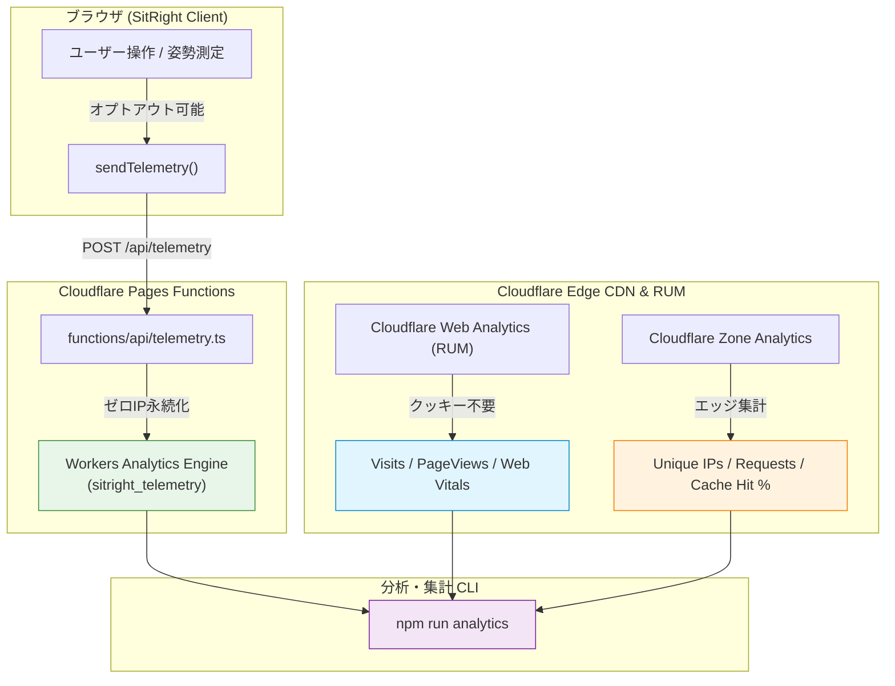

# Cloudflare Analytics & Telemetry Guide

SitRight.meにおけるアクセス・利用分析（ユニークユーザー数、セッション継続時間、ファネル離脱、パフォーマンス等）の収集・集計アーキテクチャと運用ガイドです。

---

## 1. アーキテクチャ概要

SitRight.meは**「ユーザーのプライバシーを最優先にしたオンデバイス処理」**を前提としています。カメラ映像や骨格座標はもちろん、IPアドレスもエッジで即時破棄され、サーバーへ永続保存されません。

この原則を維持したまま、サービス品質の向上と利用実態の把握を行うため、以下の3層の分析データを活用します。



---

## 2. 収集・分析できる指標一覧

### ① アプリ利用・ファネル分析（Workers Analytics Engine）
アプリのコア体験である「姿勢測定」が実際にどのくらい使われているかを正確に把握します。

| イベント名 (`event`) | 付帯情報 (`step` / `double1`) | 分析・改善への活用 |
| :--- | :--- | :--- |
| `session_start` | `step: 'monitor'` | **実際の機能利用UU（アクティブユーザー数）** の測定 |
| `session_end` | `durationSec`（秒数） | **セッション継続時間**。デスクワークで常用されているか、即離脱かを判定 |
| `camera_permission` | `step: 'granted'` or `'denied'` | **カメラ許可率**。WebRTC許可のハードルでどのくらい離脱しているか |
| `model_loaded` | `durationSec`（秒数） | **MediaPipe初期化レイテンシ**。モデルダウンロードやWASM初期化の快適性 |
| `step_transition` | `step: 'welcome' / 'setup' / ...` | **オンボーディングファネル遷移率**。どこで利用者が脱落したかを特定 |
| `error` | `errorCode` | カメラ使用中（`in_use`）、未検出（`not_found`）等の障害検知 |

### ② インフラ・エッジ分析（Zone & Web Analytics）
Cloudflare CDNおよびRUMビーコンから取得します。

| 指標 | 取得元 | 分析・改善への活用 |
| :--- | :--- | :--- |
| **Unique Visitors (UU)** | Web Analytics / Zone | サイト全体のユニーク訪問者数 |
| **Visits / Page Views** | Web Analytics (RUM) | 総セッション数とページ閲覧数 |
| **Cache Hit Ratio (%)** | Zone Analytics | 大容量モデル（WASM / `.task`）のエッジキャッシュ効率 |
| **Core Web Vitals** | Web Analytics (RUM) | LCP（最大コンテンツ描画）やINP（操作応答性） |
| **国・地域分布** | Analytics Engine / Zone | 日本語・英語・韓国語の各言語圏での利用規模 |

---

## 3. CLIでの分析データの確認 (`npm run analytics`)

プロジェクトに標準搭載された `cf-analytics.mjs` を通じて、コマンドラインから直近の指標を集計できます。

### 実行方法

```bash
# 直近7日間のサマリーを表示
npm run analytics

# 集計日数を指定（例: 直近30日間）
npm run analytics -- --days 30

# 機械可読なJSON形式で出力
npm run analytics -- --json
```

### 出力例

```text
📊 === SitRight.me Cloudflare Analytics Summary ===
📅 Period: Last 7 days (2026/10/16)
👥 App Telemetry Totals: 84 Unique Users (UU) | 112 Sessions | 553 Events

🎯 [Workers Analytics Engine — Posture & Funnel Telemetry]
┌─────────┬───────────────────┬──────────────┬─────────┬──────────────┬──────────┬───────┬──────────────────┬────────────┐
│ (index) │ Event             │ Step         │ Country │ Unique Users │ Sessions │ Count │ Avg Duration (s) │ Error Code │
├─────────┼───────────────────┼──────────────┼─────────┼──────────────┼──────────┼───────┼──────────────────┼────────────┤
│ 0       │ 'session_start'   │ 'monitor'    │ 'JP'    │ 76           │ 102      │ 128   │ '-'              │ '-'        │
│ 1       │ 'session_end'     │ 'monitor'    │ 'JP'    │ 72           │ 95       │ 115   │ '1420.5'         │ '-'        │
│ 2       │ 'camera_permiss…' │ 'granted'    │ 'JP'    │ 80           │ 106      │ 140   │ '-'              │ '-'        │
│ 3       │ 'model_loaded'    │ '-'          │ 'JP'    │ 79           │ 104      │ 135   │ '1.2'            │ '-'        │
└─────────┴───────────────────┴──────────────┴─────────┴──────────────┴──────────┴───────┴──────────────────┴────────────┘

🌐 [Edge Zone Analytics — Daily Visitors & Requests]
┌─────────┬──────────────┬─────────────────┬────────────┬────────────────┬──────────────┐
│ (index) │ Date         │ Unique Visitors │ Page Views │ Total Requests │ Cache Hit %  │
├─────────┼──────────────┼─────────────────┼────────────┼────────────────┼──────────────┤
│ 0       │ '2026-10-12' │ 42              │ 86         │ 512            │ '94%'        │
│ 1       │ '2026-10-13' │ 58              │ 124        │ 748            │ '96%'        │
└─────────┴──────────────┴─────────────────┴────────────┴────────────────┴──────────────┘
```

---

## 4. `cf` CLI と `wrangler` の役割分担（運用SSOT）

Cloudflare公式の新統合CLI `cf` (`cf-cli`) と現行ホスティング環境（Cloudflare Pages）の過渡期における役割分担です：

| 領域 | 使用ツール | 理由・背景 |
| :--- | :--- | :--- |
| **分析・監視・診断** | **`cf` CLI (`cf-cli`)** | Web Analytics（`cf rum`）やパフォーマンス測定（`cf speed`）は `cf` が主役。`npm run analytics` も `cf` のプロファイル認証を直接利用可能。 |
| **デプロイ・ホスティング** | **`wrangler` / `wrangler.toml`** | 現行の `cf` CLI (v1.0.0-beta.14) では Legacy Pages のアセットデプロイが未サポート（`cf pages deploy` 実行時に `wrangler pages deploy` を要求）。 |
| **将来移行ロードマップ** | **`cf deploy` + `cloudflare.config.ts`** | Cloudflare Workers Assets（静的配信対応 Worker）へ移行完了時に `wrangler` を完全退役させ `cf` に一本化予定。 |

---

## 5. Cloudflare 側の事前設定手順

CLIからデータを取得し、Pages Functionsでデータを蓄積するために必要な設定です。

### 1. `wrangler.toml`（設定済）
リポジトリ直下の `wrangler.toml` に、Workers Analytics Engine データセットが設定されています。
```toml
[[analytics_engine_datasets]]
binding = "ANALYTICS_ENGINE"
dataset = "sitright_telemetry"
```

### 2. 環境変数の設定 (`.env` または シェル環境)
Cloudflareダッシュボードから以下を取得し、環境変数に設定します。

```bash
# Cloudflare API Token (テンプレート「Analytics:Read」またはカスタムトークン)
export CLOUDFLARE_API_TOKEN="xxxxxxxxxxxxxxxxxxxxxxxxxxxxxxxx"

# Cloudflare アカウントID（ダッシュボードURL右側で確認可能）
export CLOUDFLARE_ACCOUNT_ID="xxxxxxxxxxxxxxxxxxxxxxxxxxxxxxxx"

# (任意) ドメインを設定している場合の Zone ID
export CLOUDFLARE_ZONE_ID="xxxxxxxxxxxxxxxxxxxxxxxxxxxxxxxx"

# (任意) Web Analytics (RUM) の Site Tag（未設定時は Pages プロジェクト sitright から自動解決）
export CLOUDFLARE_RUM_SITE_TAG="879498ce72e148db9d904495ca055bd9"
```

> **API Tokenの作成手順:**
> 1. [Cloudflare Dashboard](https://dash.cloudflare.com/) → 右上のプロフィール → **My Profile** → **API Tokens**
> 2. **Create Token** → **Account Analytics: Read**（または Account: Analytics: Read, Zone: Analytics: Read）を付与して作成。

---

## 6. プライバシー保護・外部送信規律への対応

SitRight.meは `PRIVACY.md` に基づき以下の保護を徹底しています：

1. **プライバシー配慮型の匿名UU・セッション識別**:
   - クライアント側でランダムなUUID（`clientId`: `localStorage` の `sitright.cid`、`sessionId`: メモリ上のみ）を生成し、(`blob6`, `blob7`) として集計します。
   - 氏名・IPアドレス・端末フィンガープリント等の個人特定情報は一切含まれず、設定画面でのデータ削除（「記録と基準をすべて削除」）またはオプトアウト時に即座に消去・リセットされます。
2. **映像・生体データの非送信**: カメラ映像や骨格座標（MediaPipe Landmarks）はクライアント端末内でのみ処理され、一切外部送信されません。
3. **ユーザーによるオプトアウト**:
   設定画面（**設定 → データとプライバシー → 匿名診断データの送信**）をオフにすると、クライアント側で即座に匿名IDが削除され、すべてのテレメトリ送信が停止します。
