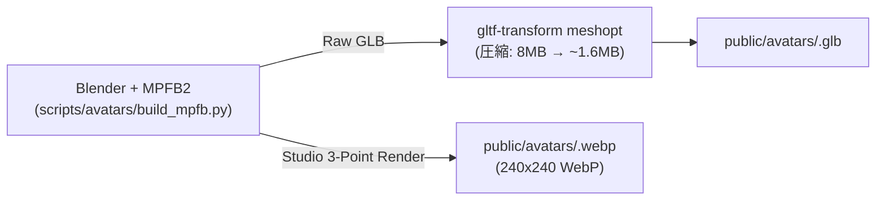

# 3D Avatar & Asset Production SSOT Guide

本ドキュメントは、SitRight.meにおける3D人物アバターおよび小道具（プロップ）の品質基準、生成パイプライン、登録手順を規定する**Single Source of Truth (SSOT)** です。
将来のAIエージェントおよび開発者が新規モデルを追加・改修する際は、本手順に従ってタスクを進行してください。

---

## 1. クリエイティブ品質基準 (Creative Quality Standard)

SitRight.meでは、ユーザーの姿勢モニタリングにおける没入感と信頼性を担保するため、以下の基準を厳格に適用します（`RULE[user_global]` 準拠）。

1. **ローポリゴンスタイルの禁止**:
   - 粗い多面体アセンブリ、意図的な曲線部でのファセット露出、平坦なプレースホルダー質感は禁止。
   - 解剖学的に自然な人体プロポーション、適切な厚み、自然な布地ドレープ・シワを表現すること。
2. **PBR質感とマテリアル**:
   - 肌、布地、金属、プラスチックはPBR（Physically Based Rendering）原則に従い、適切な Roughness / Metalness を設定する。
   - **透過モードの厳守**: GLTFエクスポート時、髪やまつ毛は `ALPHA_CLIP`（Threshold 0.5）を使用し、体や衣服は `OPAQUE` とする。`ALPHA_BLEND` はThree.jsでの描画順序ソート欠損（ハゲや透過バグ）の原因となるため禁止。
3. **着座姿勢 (Sitting Ergonomics Pose)**:
   - 立ちポーズではなく、机・オフィスチェアに自然に着座した状態でエクスポートする（大腿部が水平、膝90°、腕が机面に届く配置）。
4. **SitRight ブランドロゴの配置規則**:
   - **Tシャツ・カジュアル着**: 左胸に丸型SitRightサークルエンブレム
   - **スーツ・ジャケット・フォーマル着**: 左襟元にチタン/エナメル調のSitRightラペルピン
   - **ノートPC天板**: `src/components/PostureScene/three/props.ts` にてチタン/アルミ調の立体ロゴバッジ

---

## 2. ツールチェーン & 生成パイプライン

### 前提環境
- **Blender 5.2+**（ユーザー拡張機能で MPFB2: MakeHuman Plugin For Blender が有効化されていること）
- **Node.js 22+**
- **@gltf-transform/cli**

### パイプライン概要


### コマンド例
```bash
# 1. 3Dモデル生成 & サムネイル撮影
/opt/homebrew/bin/blender -b -P scripts/avatars/build_mpfb.py -- <avatar_id>

# 2. meshopt によるファイルサイズ最適化（必須）
npx @gltf-transform/cli meshopt public/avatars/<id>.glb public/avatars/<id>.glb
```

---

## 3. 新規アバター追加チェックリスト (Checklist)

アバターを追加・変更する際は、以下のステップをすべて完了してください。

- [ ] **1. GLB & WebP アセットの配置**:
  - `public/avatars/<id>.glb` (meshopt圧縮済み、1.5MB〜1.8MB)
  - `public/avatars/<id>.webp` (240x240、スタジオ照明、背景 `#14171c`)
- [ ] **2. モデル定義 (`src/components/PostureScene/models.ts`)**:
  - `AVATARS` 配列に `<id>` を追加
  - `GENDER_OF` レコードに性別（`'male' | 'female'`）を追加
    > ※ `MALE_AVATARS` と `FEMALE_AVATARS` は `GENDER_OF` から自動導出されるため、手動編集は不要です。
  - `AVATAR_ASSETS` に耳のオフセット（`ear`）、髪切り抜き正規表現（`cutout`）、髪色（`tint`）を追加
- [ ] **3. 多言語メッセージ登録 (`src/i18n/messages.ts`)**:
  - `ja`, `en`, `ko` の各オブジェクトに `avatar_<id>` を追加（同一キー・非空文字列）
- [ ] **4. ライセンス表記 (`THIRD_PARTY_NOTICES`)**:
  - CC0 または対象アセットのクレジット・ライセンス表記を追加
- [ ] **5. 品質ゲートの実行**:
  - `make q.check`（単体テスト、ESLint、Next.jsビルド）を実行し、すべて PASS することを確認
